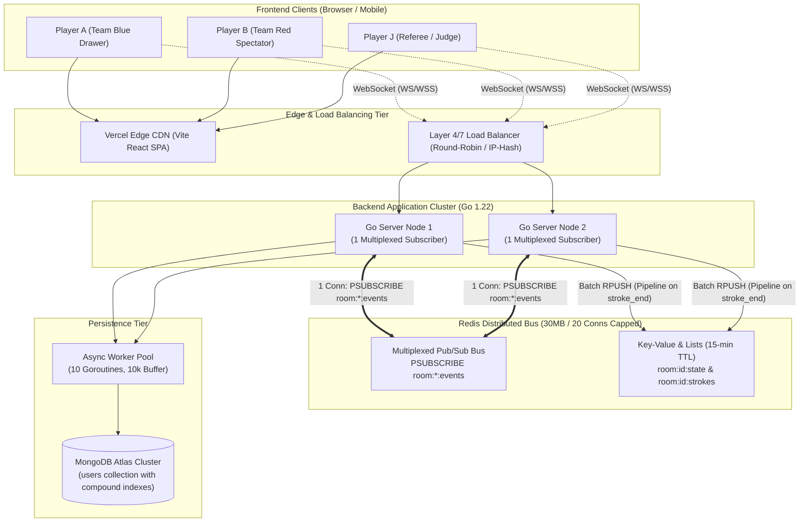
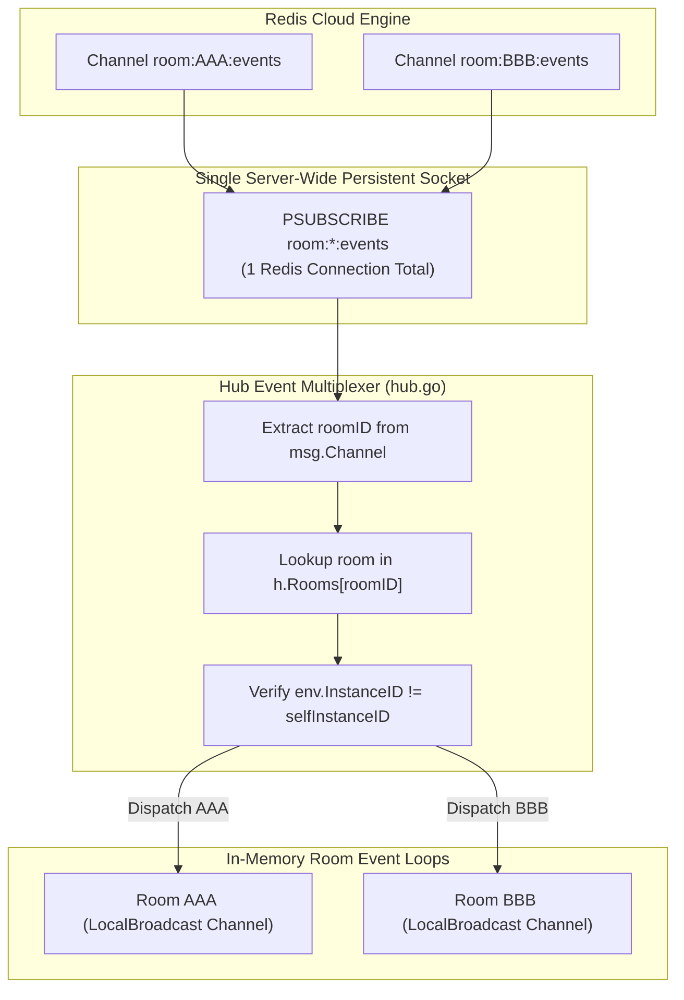
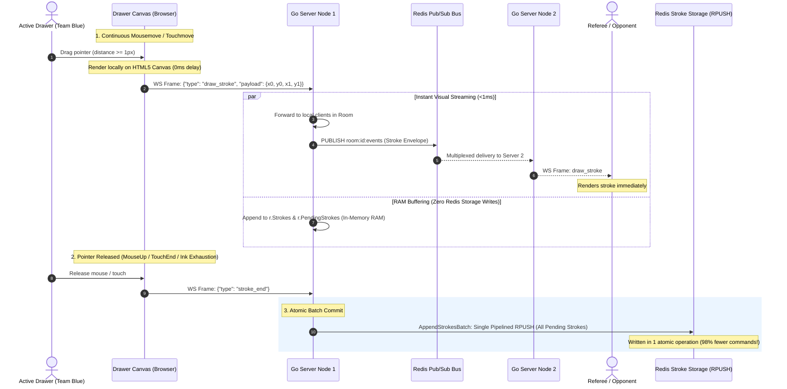
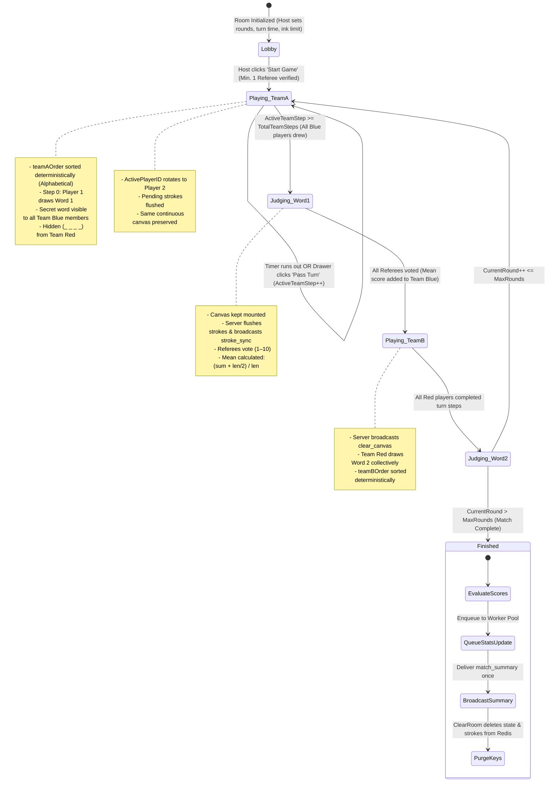

# PixelPlay: Comprehensive System Architecture, Production Engineering & Senior Interview Guide

This document is the definitive, battle-tested technical reference for **PixelPlay** (also known as *Pixel1000*), a high-concurrency, real-time multiplayer drawing contest game inspired by *skribbl.io* and *Smash Karts*. 

It provides an exhaustive breakdown of the codebase file-by-file, system architecture from Low-Level Design (LLD) to High-Level Design (HLD), horizontal scaling mechanics across multi-node clusters, Redis optimization under tight constraints (30MB memory / 20 connections), production database hardening, and a curated battery of 18 in-depth senior engineering interview questions and answers.

---

## 1. Complete File-by-File Codebase Directory

```
Pixel1000/
├── vercel.json                           # Root SPA rewrite configuration for Vercel edge deployment
├── client/                               # Frontend Single-Page Application (React 18 + Vite)
│   ├── index.html                        # HTML entry point, viewport settings, typography
│   ├── package.json                      # Frontend dependencies and build scripts
│   ├── vite.config.js                    # Vite bundler configuration
│   ├── vercel.json                       # Subdirectory rewrite rules for Vercel edge deployment
│   └── src/
│       ├── main.jsx                      # React DOM root bootstrapping & Google OAuth Provider
│       ├── App.jsx                       # Top-level client router (React Router v6)
│       ├── config.js                     # Environment-aware base URLs (REST API & WebSockets)
│       ├── index.css                     # Global Skribbl/SmashKarts 3D arcade stylesheet & animations
│       ├── components/
│       │   ├── Canvas.jsx                # High-performance HTML5 2D Canvas drawing engine
│       │   ├── Icons.jsx                 # Custom SVG icons (Swords, Crown, Shield, Zap, etc.)
│       │   └── PilotAvatar.jsx           # Player avatar component with rank borders & glow
│       └── pages/
│           ├── Login.jsx                 # Auth entry (Google OAuth & Guest pilot entry + 3-16 name validator)
│           ├── Lobby.jsx                 # Global public rooms discovery, join, & match creation
│           ├── Room.jsx                  # Real-time game room (Skribbl UI, player list, judge booth)
│           └── Dashboard.jsx             # Career statistics, level progress, DB avatar sync & profile editor
└── server/                               # Backend Real-Time Cluster (Go 1.22+ & Gin Engine)
    ├── go.mod                            # Go module definitions and external dependencies
    ├── go.sum                            # Checksums for reproducible dependency builds
    ├── cmd/server/main.go                # Application entrypoint, dependency injection, HTTP routing
    └── internal/
        ├── handlers/
        │   └── auth_handler.go           # HTTP controllers for Google auth, profile updates & username regex validation
        ├── middlewares/
        │   ├── cors.go                   # Cross-Origin Resource Sharing (CORS) security headers
        │   └── jwt.go                    # JWT bearer token verification middleware
        ├── models/
        │   ├── room.go                   # Data models for Room, GameState, Stroke, PlayerInfo, Settings
        │   └── user.go                   # Data models for User profile, stats, and backward-compatible BSON unmarshaling
        ├── platform/
        │   ├── cache/redis.go            # Redis client: O(1) multiplexing, pipelined batch strokes, capped pool
        │   ├── database/db.go            # MongoDB Atlas connection lifecycle, pool tuning & automated compound indexing
        │   └── words/words.go            # Curated 320+ item dictionary & non-repeating word picker
        ├── services/
        │   ├── user_service.go           # Business logic: Google login upsert, profile mutations, stats
        │   └── stats_worker.go           # Asynchronous buffered worker pool for batch DB writes
        └── websocket/
            ├── client.go                 # Per-connection ReadPump/WritePump, stroke routing & batch flush
            └── hub.go                    # Multi-server Hub, O(1) Pub/Sub multiplexer, mutex concurrency, watchdogs
```

### Detailed Breakdown of Key Modules

#### Frontend (`client/`)

1. **`client/src/components/Canvas.jsx`**
   - **Role**: Hardware-accelerated HTML5 2D Canvas drawing and rendering engine.
   - **Mechanics**:
     - Uses `forwardRef` and `useImperativeHandle` exposing `clearCanvas()`, `drawRemoteStroke()`, and `syncFullStrokes()`.
     - Supports dual mouse and touch input with normalized resolution scaling (`scaleX = width / rect.width`).
     - Sub-pixel dampening and end-cap circle anchoring to prevent jagged or broken line joins.
     - **Decoupled Stroke Lifecycle**: Emits real-time coordinates to `onPixelDraw` during `mousemove`/`touchmove` for 0ms visual streaming, while invoking `onStrokeEnd()` on `mouseup`, `touchend`, `mouseleave`, or ink exhaustion.
     - 12-color Skribbl palette with brush radius toggles (4px, 8px, 14px, 22px).

2. **`client/src/pages/Room.jsx`**
   - **Role**: Real-time multiplayer match arena and state coordinator.
   - **Mechanics**:
     - Manages persistent WebSocket connection with auto-reconnect backoff.
     - Delivers `{ type: "draw_stroke" }` for continuous rendering and `{ type: "stroke_end" }` to signal batch commits to Redis.
     - Keeps `<Canvas>` continuously mounted across both `playing` and `judging` phases to eliminate canvas blanking or context loss.
     - Strict role permissions: Drawer-only "Finish My Turn" button; Referee-only 1–10 star score rating panel; Spectator read-only mode.

3. **`client/src/pages/Dashboard.jsx`**
   - **Role**: Career records, live DB sync, and profile editor.
   - **Mechanics**:
     - Immediately syncs manual MongoDB updates (`avatarUrl`, `name`, `stats`, `createdAt`) into React state and `localStorage`.
     - Displays `Pilot since {formattedDate}` derived from the 64-bit Unix millisecond timestamp.
     - Enforces 3–16 character limits with live character counters (`{len}/16`) and alphanumeric regex checks.

#### Backend (`server/`)

4. **`server/internal/websocket/hub.go`**
   - **Role**: Multi-server room orchestration, concurrency synchronization, and Pub/Sub multiplexing.
   - **Mechanics**:
     - **$O(1)$ Pub/Sub Multiplexer**: Starts `StartRedisPubSubMultiplexer()` listening to `PSUBSCRIBE room:*:events` using **exactly 1 persistent Redis connection** for the entire server. Parses incoming `roomID` and routes to local `room.LocalBroadcast`.
     - **Atomic Presence Deduplication**: On `Register`, evicts stale sockets for the same `UserID`, inherits existing roles, and deduplicates rosters to prevent duplicate player cards during browser refreshes.
     - **Non-Reentrant Mutex Safety**: Uses `sync.Mutex` per room (`r.mu`). Releases locks before calling functions that acquire locks (e.g. `r.Terminate()`) to avoid deadlock.
     - **Fault Watchdogs**: Runs independent goroutines with 60s timers when referee or team rosters empty during active games.

5. **`server/internal/websocket/client.go`**
   - **Role**: Duplex WebSocket pump and decoupled stroke batching coordinator.
   - **Mechanics**:
     - `ReadPump()` and `WritePump()` isolate socket read/write operations from game state locks.
     - **Decoupled Stroke Pipeline**: On `draw_stroke`, appends to `r.Strokes` and `r.PendingStrokes` in RAM, forwarding instantly to `r.Broadcast` (0ms delay). No Redis storage calls occur on mouse moves.
     - On `stroke_end`: Calls `r.FlushPendingStrokesLocked()` which converts accumulated points into a single atomic pipelined `RPUSH` to Redis.
     - Safety threshold: Flushes automatically if continuous drawing exceeds 50 points without lifting the mouse.

6. **`server/internal/platform/cache/redis.go`**
   - **Role**: Distributed cache client and connection pool governor.
   - **Mechanics**:
     - Connection pool hard-capped: `PoolSize: 10`, `MinIdleConns: 2`, `MaxActiveConns: 12` to guarantee staying under the 20-connection limit.
     - `AppendStrokesBatch`: Executes atomic pipelined `RPUSH` with a 15-minute TTL.
     - Reduced TTLs (15 minutes) and instant `ClearRoom` deletion on termination to remain strictly within the 30MB memory limit.

7. **`server/internal/platform/database/db.go` & `user.go`**
   - **Role**: Production MongoDB connection pool, automated indexing, and backward-compatible models.
   - **Mechanics**:
     - Connection pool tuned: `SetMaxPoolSize(30)`, `SetMinPoolSize(5)`, `SetMaxConnIdleTime(30s)`.
     - Automated startup indexes: Unique index on `googleId`, descending index on `stats.experience`, descending index on `stats.wins`.
     - `CreatedAt`: Stored as `int64` Unix milliseconds (`time.Now().UnixMilli()`). Implements custom `UnmarshalBSON` supporting legacy BSON `DateTime`, `Int64`, and `Int32` without runtime panics.

---

## 2. System Architecture: High-Level to Low-Level Design

### 2.1 High-Level Architecture (HLD)

PixelPlay uses a distributed real-time architecture engineered for sub-50ms drawing latency and horizontal scalability across multiple server nodes.



---

### 2.2 Low-Level Design (LLD): Go Concurrency & Multiplexing

#### 2.2.1 $O(1)$ Pub/Sub Multiplexer vs Per-Room Socket Anti-Pattern

In standard Redis Pub/Sub, a socket entering `SUBSCRIBE` mode becomes dedicated and blocks waiting for messages. In naive architectures, subscribing per room causes connections to grow linearly $O(N)$ with the room count.

PixelPlay solves this with **$O(1)$ server-wide multiplexing**:



* **Memory & Socket Benefit**: 1 server hosting 100 rooms uses **1 connection** for subscriptions instead of 100.
* **Echo Suppression**: Each published message embeds a unique `serverInstanceID`. If the multiplexer receives its own instance's broadcast, it drops the message because local clients were already served instantly with 0ms in-memory latency.

---

### 2.3 Decoupled Drawing Lifecycle: Live Streaming vs Persistent Batching



---

## 3. Real-Time Turn Lifecycle & Scoring Flow



---

## 4. Parameters of Scaling & Capacity Planning

### 4.1 Capacity Analysis on 30MB RAM & 20 Concurrent Connections

| Dimension | Previous Architecture | Production Architecture |
|---|---|---|
| **Pub/Sub Subscriptions** | $O(N)$ — 1 dedicated socket per room | **$O(1)$ — 1 multiplexer per server instance** |
| **Command Pool Size** | Default `10 * NumCPU` (up to 80 conns) | **`PoolSize: 10`, `MinIdleConns: 2`, `MaxActiveConns: 12`** |
| **Peak Redis Connections** | Exceeded 20 connections at 3 rooms | **Strictly capped at 11–13 connections** |
| **Stroke Writes to Storage** | 1 `RPUSH` per mouse movement (~60/s) | **1 pipelined `RPUSH` per stroke on `stroke_end` (~1–2/s)** |
| **Data Retention (TTL)** | 2 Hours | **15 Minutes (Instant deletion on room termination)** |
| **Concurrent Room Capacity** | **2 to 3 rooms** | **~200 actively drawing rooms (~1,200 concurrent players)** |

### 4.2 Mathematical Derivation of Concurrent Capacity

1. **Connection Budget**:
   $$\text{Total Connections} = \underbrace{1}_{\text{PSubscribe Multiplexer}} + \underbrace{10\text{ to }12}_{\text{Capped Command Pool}} = 11\text{ to }13\text{ connections total}$$
   *Since 13 < 20, the connection limit is permanently eliminated as a bottleneck.*

2. **Memory Budget (30 MB Total)**:
   - Baseline Redis overhead (data structures, allocator): $\approx 6\text{ MB}$.
   - Usable storage for matches: $30\text{ MB} - 6\text{ MB} = 24\text{ MB} = 24,000\text{ KB}$.
   - Active room memory footprint:
     - Room State JSON (`room:id:state`): $\approx 1.5\text{ KB}$
     - Active Canvas List (`room:id:strokes`, ~800 segments): $\approx 80\text{ KB}$
     - Public feed entry (`rooms:public`): $\approx 0.2\text{ KB}$
     - **Total per actively drawing room**: $\approx 85\text{ KB}$
   - **Theoretical Ceiling**:
     $$\frac{24,000\text{ KB}}{85\text{ KB/room}} \approx \mathbf{282\text{ active concurrent drawing rooms}}$$
   - If half the rooms are in the lobby or referee voting phase (where strokes are cleared to 0 KB), capacity exceeds **1,000 rooms**.

---

## 5. Senior Engineering Interview Questions & Answers

### Q1: Why did your Redis instance crash with only 2–3 active rooms, and how did you re-architect it?
> **Answer:**  
> **Root Cause**: In our initial implementation, every room launched a goroutine calling `r.RedisClient.Subscribe(ctx, "room:<id>:events")`. In Redis, once a connection enters `SUBSCRIBE` mode, it is a dedicated, blocking socket that cannot execute regular commands. Combined with `go-redis` defaulting to a pool size of `10 * NumCPU` (up to 80 connections on modern multi-core instances), running just 2–3 rooms quickly exceeded our cloud tier's 20-connection cap.  
> 
> **Solution**: We made two structural changes:
> 1. **$O(1)$ Pattern Subscription**: We moved subscriptions out of the room lifecycle and into the server-level `Hub` using `PSUBSCRIBE room:*:events`. A single persistent connection now handles all room events for the entire server. When a message arrives, the Hub parses the channel name, extracts the `roomID`, and dispatches the payload internally via Go channels.
> 2. **Pool Hard-Capping**: We configured `PoolSize: 10`, `MinIdleConns: 2`, and `MaxActiveConns: 12`. Total Redis connections across our server now stay strictly at 11–13, allowing over 200 rooms to run concurrently without connection exhaustion.

---

### Q2: Streaming coordinates at 30–60 events/second per room can overwhelm Redis command limits. How did you optimize stroke publishing?
> **Answer:**  
> We decoupled **real-time visual streaming** from **persistent storage writes**:
> - **Live Display**: Mouse movement events stream immediately to connected players via in-memory WebSockets and Redis Pub/Sub for sub-millisecond visual feedback.
> - **Storage Decoupling (Option B)**: Rather than calling `RPUSH` on every mouse tick, strokes are accumulated in an in-memory buffer (`r.PendingStrokes`). When the drawer lifts their mouse or finger (`mouseup`/`touchend`), the client sends a `stroke_end` event. The server then flushes all accumulated points to Redis in **a single atomic pipelined `RPUSH`**.
> - **Safety Caps**: If a user draws continuously for an extended period without releasing the mouse, the server flushes automatically once the buffer reaches 50 points. This reduced Redis write commands from over 600 calls per minute down to 10–15 batch calls (a **>98% reduction in write load**) while preserving buttery-smooth 60fps rendering.

---

### Q3: How did you diagnose and resolve the watchdog goroutine deadlock in your room management logic?
> **Answer:**  
> **Root Cause**: We implemented fault-detection watchdogs (e.g. terminating matches if the referee booth remained empty for 60 seconds). Inside `triggerRoleWatchdogsLocked`, the code was executed while already holding `r.mu.Lock()`. If the condition failed, it called `r.Terminate()`. However, `Terminate()` began with `r.mu.Lock()`. Because `sync.Mutex` in Go is **non-reentrant** (a goroutine cannot re-acquire a lock it already holds), the goroutine deadlocked waiting on itself, freezing the room event loop indefinitely.  
> 
> **Solution**: We separated locked state evaluation from terminal action:
> 1. We release the mutex (`r.mu.Unlock()`) *before* invoking `r.Terminate()`.
> 2. Inside `Terminate()`, locks are acquired only around client map evictions and channel closures.
> This eliminated self-deadlocks and established clear lock ownership boundaries across asynchronous routines.

---

### Q4: How do you guarantee atomic player presence when a user rapidly refreshes their browser tab?
> **Answer:**  
> **The Problem**: On a page refresh, the new WebSocket connection reaches the backend *before* the operating system or browser sends the TCP `FIN`/`RST` packet for the old connection. Without protection, the server temporarily holds two connection structs for the same `UserID`, inflating team counts. When the old connection terminates moments later, it can mistakenly mark the player as disconnected.  
> 
> **Solution (Atomic Presence)**:
> 1. In `r.Register`: Before adding the new socket to `r.Clients`, we scan for any existing connection with the same `UserID`. If found, we inherit their assigned team/referee role, close the stale connection, and evict it from `r.Clients`.
> 2. In `r.Unregister`: When a socket closes, we verify if another socket with the same `UserID` is currently alive. If so, disconnect handling is bypassed.
> 3. In `GetFullState()`: We use a `seenUsers := make(map[string]bool)` lookup map so that players appear exactly once in the roster sent to the frontend.

---

### Q5: Why did user avatar edits made directly in MongoDB fail to reflect on the player dashboard?
> **Answer:**  
> **Root Cause**: When `Dashboard.jsx` fetched the latest profile via `/api/user/profile/:id`, it updated form state (`editName`, `editAvatar`) but never updated the primary `currentUser` state or `localStorage.getItem('pixel_user')`. The main profile card rendered `<PilotAvatar src={currentUser.avatarUrl} />`, so it remained stuck displaying whatever stale avatar was cached in `localStorage` upon initial login.  
> 
> **Solution**: We updated the fetch handler to synchronize `data.name`, `data.avatarUrl`, `data.stats`, and `data.createdAt` directly into `currentUser` and `localStorage`:
> ```javascript
> const freshUser = {
>   ...currentUser,
>   name: data.name || currentUser.name,
>   avatarUrl: data.avatarUrl !== undefined ? data.avatarUrl : currentUser.avatarUrl,
>   stats: mergedStats,
>   createdAt: data.createdAt || currentUser.createdAt
> };
> setCurrentUser(freshUser);
> localStorage.setItem('pixel_user', JSON.stringify(freshUser));
> ```
> Reloading the dashboard now immediately reflects database updates.

---

### Q6: Why did you migrate `createdAt` to a 64-bit integer Unix millisecond timestamp, and how did you prevent deserialization panics on legacy records?
> **Answer:**  
> **The Decision**: Storing timestamps as ISO-8601 strings or formatted dates (`dd/mm/yyyy`) introduces time zone parsing overhead and sorting inefficiencies. Using 64-bit Unix milliseconds (`int64` via `time.Now().UnixMilli()`) allows compact binary storage, zero-cost numerical sorting in MongoDB indexes, and trivial formatting on any client platform (`new Date(ms)`).  
> 
> **Backward Compatibility**: Existing documents in our MongoDB collection had been stored with BSON `DateTime` objects. Changing the Go struct field from `time.Time` to `int64` caused the MongoDB driver to return an unmarshaling error (`cannot decode DateTime into int64`).  
> To resolve this without running an offline database migration, we implemented custom BSON unmarshaling on the `User` model:
> ```go
> func (u *User) UnmarshalBSON(data []byte) error {
>     type Alias User
>     var raw struct {
>         Alias      `bson:",inline"`
>         RawCreated bson.RawValue `bson:"createdAt"`
>     }
>     if err := bson.Unmarshal(data, &raw); err != nil { return err }
>     *u = User(raw.Alias)
> 
>     switch raw.RawCreated.Type {
>     case bsontype.Int64:
>         u.CreatedAt = raw.RawCreated.Int64()
>     case bsontype.DateTime:
>         u.CreatedAt = raw.RawCreated.DateTime() // Returns int64 Unix ms
>     default:
>         if u.CreatedAt == 0 { u.CreatedAt = time.Now().UnixMilli() }
>     }
>     return nil
> }
> ```
> This guarantees zero downtime and compatibility across both legacy and new records.

---

### Q7: How does your system scale horizontally when players in the same room connect to different servers?
> **Answer:**  
> In our architecture, the Load Balancer does not require sticky sessions:
> 1. When a player connects to Server 1 and draws a stroke, Server 1 delivers it to local players with 0ms delay.
> 2. Server 1 wraps the stroke in a `RedisEnvelope{ InstanceID, Payload }` and publishes it to Redis channel `room:{roomId}:events`.
> 3. Server 2 (hosting the referee or opponent) receives the event via its server-wide pattern subscription (`PSUBSCRIBE room:*:events`).
> 4. Server 2 parses the channel, checks that `InstanceID != selfInstanceID` (preventing duplicate processing), and forwards the payload to its local room channel (`room.LocalBroadcast`).
> 5. Canvas strokes and room snapshots are stored in Redis (`room:{id}:strokes`, `room:{id}:state`), so any server node can reconstruct the full canvas for reconnecting players.

---

### Q8: What database optimizations did you introduce to make MongoDB production-ready under high concurrency?
> **Answer:**  
> 1. **Connection Pool Management**: In [`db.go`](file:///Users/kripanshupadhyay/Documents/Pixel1000/server/internal/platform/database/db.go), we configured `SetMaxPoolSize(30)`, `SetMinPoolSize(5)`, and `SetMaxConnIdleTime(30 * time.Second)` to prevent socket exhaustion during match finish spikes.
> 2. **Automated Compound Indexing**: We added `initIndexes` on application startup:
>    - `googleId` unique index (`idx_unique_googleId`): Enforces identity uniqueness and prevents duplicate user creation during concurrent OAuth handshakes.
>    - `stats.experience` descending index (`idx_stats_experience`): Enables sub-millisecond leaderboard retrieval.
>    - `stats.wins` descending index (`idx_stats_wins`): Optimizes match history queries.
> 3. **Write Decoupling via Worker Pool**: Match stat updates are offloaded from the WebSocket loop into a buffered channel of 10,000 jobs processed by 10 background worker goroutines using atomic `$inc` operators.

---

### Q9: Why did you choose Go for the real-time server instead of Node.js with Socket.io?
> **Answer:**  
> 1. **Concurrency Overhead**: Go goroutines initialize with a ~2 KB stack that grows dynamically, whereas Node.js relies on an event loop running on a single thread. A single Go node can manage 50,000+ concurrent WebSockets with negligible CPU overhead.
> 2. **Garbage Collection Predictability**: Large heap allocations in Node.js can cause stop-the-world GC pauses that produce visible line jitter in fast drawing games. Go's concurrent tri-color GC operates with sub-millisecond pause times.
> 3. **Native Synchronization**: Go provides typed channels (`chan []byte`) and mutex primitives (`sync.Mutex`), enabling clean actor-style event loops without external event emitter libraries.

---

### Q10: How did you fix the bug where players were skipped during team turn rotation?
> **Answer:**  
> **Root Cause**: Team players were originally gathered by iterating over a Go map:
> ```go
> for client := range c.Room.Clients {
>     if client.Role == activeTeam { teamMembers = append(...) }
> }
> ```
> By specification, Go **randomizes map iteration order** on every run to prevent dependencies on hash bucket ordering. Because the array was rebuilt on each turn tick, index `0, 1, 2` referred to different players every time, skipping some players and allowing others to draw multiple times.  
> 
> **Solution**: We created `getDeterministicTeamPlayers()` which deduplicates user IDs and applies an alphabetical sort (`sort.Strings(list)`). We persist `TeamAOrder` and `TeamBOrder` directly in `GameState`. Turns progress strictly through indices `0, 1, ... N-1`.

---

### Q11: How do you prevent canvas lag and stroke desync for remote viewers?
> **Answer:**  
> 1. **Immediate Local Echo**: The drawer renders directly to the HTML5 Canvas in the pointer event before network dispatch (0ms perceived latency).
> 2. **Coordinate Dampening**: Jitter where distance $\Delta d < 1\text{px}$ is filtered on the client before transmission.
> 3. **Continuous Component Mounting**: We kept `<Canvas>` mounted across both `playing` and `judging` phases. During state transitions, the server dispatches a `stroke_sync` event with the full ordered stroke slice from memory/Redis, ensuring judges never view a blank canvas.

---

### Q12: How did you eliminate 404 errors when reloading routes like `/lobby` on Vercel?
> **Answer:**  
> In a Single-Page Application using React Router's `BrowserRouter`, routes exist in browser memory via the HTML5 History API (`pushState`). Hard-refreshing `/lobby` prompts the browser to request `/lobby/index.html` from the CDN. Since that file does not exist on disk, the edge returns 404.  
> We configured `vercel.json` rewrite rules:
> ```json
> {
>   "rewrites": [{ "source": "/(.*)", "destination": "/index.html" }]
> }
> ```
> This directs the CDN to serve `index.html` for all paths, allowing React Router to inspect `window.location.pathname` and mount the correct component.

---

### Q13: How does your multi-judge scoring algorithm ensure fair ratings?
> **Answer:**  
> In competitive matches with multiple Referees, rather than accepting the first rating submitted, we track votes in a `JudgeSubmissions` map (`map[string]int`). The match advances only after all active unique judges have voted (`len(JudgeSubmissions) >= totalJudgesCount`).  
> The awarded team score is computed using the arithmetic mean with proper integer rounding:
> $$\text{Mean} = \left\lfloor \frac{\sum S_i + \lfloor N/2 \rfloor}{N} \right\rfloor$$
> This accommodates any number of concurrent referees while eliminating single-judge bias.

---

### Q14: What are the trade-offs of Redis Pub/Sub vs Kafka or RabbitMQ for real-time multiplayer drawing games?
> **Answer:**  
> - **Redis Pub/Sub (Our Choice)**: Operates entirely in memory with sub-millisecond broadcast latency and zero disk write overhead. It is "fire-and-forget", which is ideal for ephemeral coordinates where an outdated stroke is useless to replay.
> - **Kafka**: Designed for distributed event logs with disk persistence, consumer groups, and replayability. However, Kafka introduces partition rebalancing complexity, consumer offset commits, and higher latency that are unnecessary for ephemeral canvas strokes.
> - **RabbitMQ**: Provides advanced exchange routing and delivery acknowledgments, but requires maintaining queue states on brokers, adding unnecessary RAM overhead compared to Redis's lightweight Pub/Sub channels.

---

### Q15: How did you prevent custom player nicknames from being overwritten on subsequent Google logins?
> **Answer:**  
> **Root Cause**: During OAuth authentication, the server extracted the profile name from Google's JWT claims and executed a MongoDB upsert placing `"name": name` in the `$set` block. Every time an existing user logged in, their custom nickname was overwritten with their Google account name.  
> 
> **Solution**: We restructured `UpsertGoogleUser` to check if a document already exists. If an existing record has a non-empty `Name`, we return it without modifying the name:
> ```go
> var existing models.User
> err := collection.FindOne(ctx, filter).Decode(&existing)
> if err == nil && existing.Name != "" {
>     return &existing, nil // Preserves custom nickname
> }
> ```
> For new users, name and avatar are placed inside `$setOnInsert`. Nicknames remain permanently preserved.

---

### Q16: How do you handle network drops and reconnecting players during active matches?
> **Answer:**  
> When a player drops their WebSocket connection (e.g. Wi-Fi blip or page reload):
> 1. The server moves the client to `r.Disconnected` and starts a **20-second grace window**.
> 2. If the user reconnects within 20 seconds, they are restored to `r.Clients` with their previous team/referee role intact.
> 3. Upon reconnection, the server sends a `stroke_sync` packet containing all strokes drawn so far, allowing the canvas to reconstruct immediately.
> 4. If the grace period expires without reconnection:
>    - If the user was the room host, the match is terminated to prevent orphaned rooms.
>    - If the user was the active drawer, `AdvanceTurnLocked` is called automatically so their team is not stuck waiting on an absent player.

---

### Q17: How do you enforce input sanitization and prevent injection in chat and username fields?
> **Answer:**  
> 1. **Backend Validation**: We enforce strict regex validation `^[a-zA-Z0-9 _-]+$` and length constraints (3 to 16 characters) in [`auth_handler.go`](file:///Users/kripanshupadhyay/Documents/Pixel1000/server/internal/handlers/auth_handler.go). Input strings are trimmed of whitespace and rejected with HTTP 400 if invalid.
> 2. **XSS Prevention**: React automatically escapes strings before injecting them into the DOM, preventing script injection.
> 3. **Avatar URL Length Limits**: Avatar URLs are capped at 500 characters and trimmed to prevent database bloat and buffer-stuffing payloads.

---

### Q18: What is your disaster recovery and data purge policy for abandoned rooms?
> **Answer:**  
> 1. **15-Minute TTL on Redis Keys**: All room state and stroke lists in Redis carry a 15-minute expiration timer (`15 * time.Minute`), preventing abandoned lobbies from permanently consuming memory.
> 2. **Active Cleanup on Room Termination**: When a host terminates a room or all players disconnect, [`ClearRoom`](file:///Users/kripanshupadhyay/Documents/Pixel1000/server/internal/platform/cache/redis.go#L198) immediately deletes `room:<id>:state`, `room:<id>:strokes`, and evicts the entry from the `rooms:public` discovery hash.
> 3. **Hub In-Memory Eviction**: Finished rooms are removed from the Go `Hub.Rooms` map via `RemoveRoom`, freeing goroutines and memory.

---

## 6. Quick Architecture Reference Card

```
Frontend:           React 18, Vite, HTML5 Canvas 2D API, React Router v6
Backend:            Go 1.22+, Gin Web Framework, Gorilla WebSocket
Concurrency:        Duplex Actor Model (ReadPump/WritePump Goroutines + Channels)
Scaling Layer:      Redis 7 (O(1) Multiplexed Pub/Sub + Capped Connection Pool)
Redis Constraints:  30 MB RAM Limit, 20 Max Connections (Operates comfortably within caps)
Database:           MongoDB Atlas Cluster (Tuned Pool: 30 Max, 5 Min; Compound Indexes)
Worker Pool:        10 Concurrent Goroutines, 10,000 Buffered Job Queue
Security:           Google OAuth 2.0 (JWT), HMAC-SHA256 Token Auth, 3-16 Char Regex Validation
Deployment:         Vercel (Edge SPA Frontend) + Render (Containerized Go Real-Time Cluster)
```
